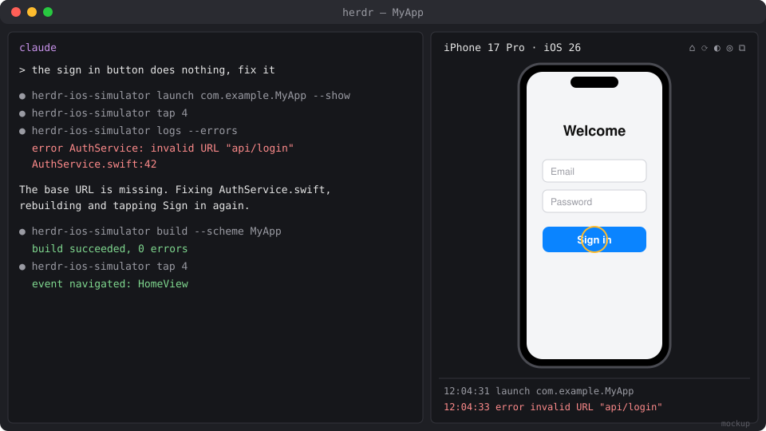

# herdr-ios-simulator

An iOS Simulator inside [herdr](https://herdr.dev). The simulator opens in a pane next to your coding agent, so you and your agent use the same device, and the agent can read every log, crash and event the app produces.

> **Status: early, not yet released.** The CLI works against real simulators; the live pane has not been tested by hand yet. The screenshot below is a mockup. See [docs/FEATURES.md](docs/FEATURES.md) for what's planned.



## What it does

### Opens beside your agent

Run **Simulator: open** from herdr, or let the agent run `herdr-ios-simulator boot --show`. The device boots without Simulator.app and appears in a herdr pane. Click to tap, drag to swipe, type to type. The header has Home, Lock, Screenshot and Quit buttons.

### Agents build, run and drive the app

The agent builds with `xcodebuild` and gets back only the errors and warnings, with file:line. It installs and launches the app, lists what's on screen, and taps and types like you would. You watch it happen and can take over at any point.

### Every log and event, on demand

`logs` returns the app's unified log and its `print()` output. `crashes` returns crash reports with the exception and the top frames. `events` returns the device's timeline: boots, installs, launches, and your taps in the pane. Nothing streams into the agent's context until it asks.

## Requirements

1. macOS with Xcode and an iOS runtime. Check with `xcrun simctl list devices available`.
2. [AXe](https://github.com/cameroncooke/AXe) for taps, typing, the on-screen element list and the live view, because `simctl` has no input commands:

   ```sh
   brew install cameroncooke/axe/axe
   ```

3. Rust (`cargo`), because herdr builds the plugin from source when it installs.

No Screen Recording or Accessibility permission is needed.

## Install

```sh
herdr plugin install MattJColes/herdr-ios-simulator
```

herdr shows the commands the plugin will run, builds it with `cargo build --release`, and links `herdr-ios-simulator` into `~/.local/bin` the next time herdr starts. To link it straight away:

```sh
herdr plugin action invoke herdr-ios-simulator.install-cli
```

## Update

```sh
herdr plugin update herdr-ios-simulator
```

This fetches the latest commit and rebuilds. A pane that is already open keeps running the old build; close it and open it again to get the new one. The `~/.local/bin` link follows the new build after herdr's next start, or straight away with the `install-cli` action above.

## Uninstall

```sh
herdr plugin uninstall herdr-ios-simulator
```

That unregisters the plugin but leaves its link, settings and recorded state in place. To remove those too:

```sh
rm ~/.local/bin/herdr-ios-simulator
rm -rf ~/.local/state/herdr/plugins/herdr-ios-simulator
rm -rf ~/.config/herdr/plugins/config/herdr-ios-simulator
```

Your simulators and their apps are untouched. AXe stays installed until you run `brew uninstall axe`.

## For agents

```sh
herdr-ios-simulator boot "iPhone 18 Pro" --show   # boot and show it to the user
herdr-ios-simulator build --scheme MyApp --run    # errors/warnings with file:line, then install and launch
herdr-ios-simulator describe                      # [4] Button "Sign in"
herdr-ios-simulator tap 4
herdr-ios-simulator type "hello" --submit
herdr-ios-simulator mark before-login
herdr-ios-simulator logs --errors --since before-login
herdr-ios-simulator crashes
herdr-ios-simulator screenshot /tmp/screen.png
```

`herdr-ios-simulator agent-help` prints the full list. Add `--json` to any command for structured output, and `--device NAME` to pick a simulator when several are booted.

## Using the pane

| Input | What it does |
|---|---|
| Click | Tap |
| Drag | Swipe |
| Scroll wheel | Scroll |
| Typing, Return, Backspace, Tab | Sent to the focused field |
| Ctrl-O | Home |
| Ctrl-X | Screenshot (saved under the plugin's state folder) |
| Ctrl-Q | Close the pane (the simulator keeps running) |

## Settings

Optional. Put them in `~/.config/herdr/plugins/config/herdr-ios-simulator/config.toml`:

```toml
default_device = "iPhone 18 Pro"   # what `boot` and the pane use when nothing is booted
fps = 15                           # live view frame rate, 1-30
view_renderer = "blocks"           # if the pane stays blank in your terminal
cell_aspect = 2.6                  # if the device looks stretched
```

## Development

```sh
git clone git@github.com:MattJColes/herdr-ios-simulator.git
cd herdr-ios-simulator
cargo build --release
herdr plugin link .
git config core.hooksPath .githooks   # once per clone: fmt, clippy and tests before each commit
```

`herdr plugin link` doesn't run build commands, so rebuild with `cargo build --release` after each change. CI runs `cargo fmt`, `clippy` and the tests on macOS for every pull request. Release Please opens a release PR from Conventional Commits.

## License

MIT. See [LICENSE](LICENSE).
