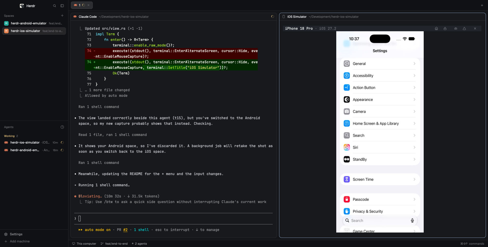
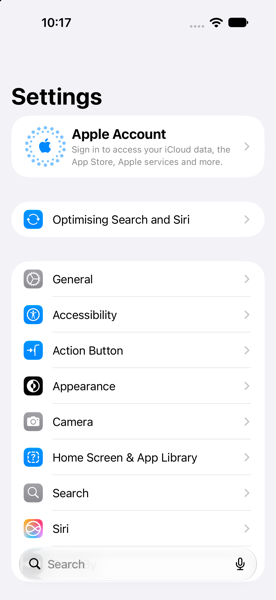
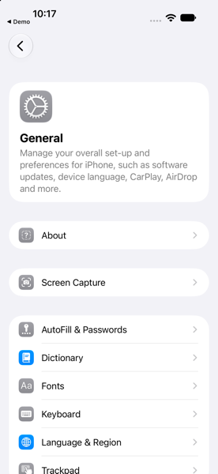

# herdr-ios-simulator

An iOS Simulator inside [herdr](https://herdr.dev). The simulator opens in a pane next to your coding agent, so you and your agent use the same device, and the agent can read every log, crash and event the app produces.

> **Status: early.** Tested end to end in herdr desktop 0.9.5 with Xcode 27 (iOS 27.2): the view, its buttons, the + menu and every CLI command below. See [docs/FEATURES.md](docs/FEATURES.md) for what's planned.



| Agent runs `herdr-ios launch com.apple.Preferences` | then `herdr-ios ui` and `herdr-ios tap 10` |
|---|---|
|  |  General, opened by the agent tapping element 10"> |

## What it does

### A view beside your agent

Pick **iOS Simulator** from herdr desktop's + menu, run **Simulator: open** from herdr, or let the agent run `herdr-ios boot --show`. The device boots without Simulator.app and appears in a view: a herdr pane beside your agent. Click to tap, drag to scroll (at the speed you drag, so a quick flick flings), scroll the wheel to scroll, type to type. The header has icon buttons, in herdr desktop's style, for Home, Lock, send a screenshot to the agent, send the app's recent errors to the agent, and close.

### Agents build, run and drive the app

The agent builds with `xcodebuild` and gets back only the errors and warnings, with file:line. It installs and launches the app, lists what's on screen, and taps and types like you would. You watch it happen and can take over at any point.

### Every log and event, on demand

`logs` returns the app's unified log and its `print()` output. `crashes` returns crash reports with the exception and the top frames. `events` returns the device's timeline: boots, installs, launches, and your taps in the view. Nothing streams into the agent's context until it asks.

## Requirements

1. [herdr](https://herdr.dev) 0.9.0 or later. herdr desktop gives you the + menu entry and header buttons; the terminal app works too.
2. macOS with Xcode and an iOS runtime. Check with `xcrun simctl list devices available`.
3. [AXe](https://github.com/cameroncooke/AXe) 1.8.0 or later for taps, typing, the on-screen element list and the live view, because `simctl` has no input commands. Xcode 27 needs 1.8.0 or later.

   ```sh
   brew install cameroncooke/axe/axe
   ```

4. Rust (`cargo`), because herdr builds the plugin from source when it installs.
5. `~/.local/bin` on your `PATH`, so you and your agents can run `herdr-ios`. Check with `echo $PATH`.

No Screen Recording or Accessibility permission is needed.

## Install

```sh
herdr plugin install MattJColes/herdr-ios-simulator
```

herdr shows the commands the plugin will run, builds it with `cargo build --release`, and links `herdr-ios` into `~/.local/bin` the next time herdr starts. To link it straight away:

```sh
herdr plugin action invoke herdr-ios-simulator.install-cli
```

For herdr desktop, add **iOS Simulator** to its + menu (it opens as a split beside your agent):

```sh
herdr-ios install-desktop
```

To have Claude Code, Codex, OpenCode and Pi reach for `herdr-ios` whenever you ask to run or debug an iOS app, in every project:

```sh
herdr-ios install-agents
```

This writes a Claude Code skill to `~/.claude/skills/herdr-ios-simulator/` and adds a short marked section to the other agents' global `AGENTS.md`. Running it again replaces that section rather than adding another. herdr's command palette has the same thing as **Simulator: set up agents**.

For any other agent, install the skill with the [skills](https://github.com/vercel-labs/skills) CLI, the same way herdr installs its own skill:

```sh
npx skills add MattJColes/herdr-ios-simulator -g
```

`herdr-ios skill` prints the skill, to paste into an agent that has no skill system.

## Update

```sh
herdr plugin update herdr-ios-simulator
```

This fetches the latest commit and rebuilds. A view that is already open keeps running the old build; close it and open it again to get the new one. The `~/.local/bin` link follows the new build after herdr's next start, or straight away with the `install-cli` action above.

## Uninstall

```sh
herdr plugin uninstall herdr-ios-simulator
```

That unregisters the plugin but leaves its link, settings and recorded state in place. To remove those too:

```sh
rm ~/.local/bin/herdr-ios
rm -rf ~/.local/state/herdr/plugins/herdr-ios-simulator
rm -rf ~/.config/herdr/plugins/config/herdr-ios-simulator
rm -rf ~/.claude/skills/herdr-ios-simulator   # and the herdr-ios-simulator section in ~/.codex, ~/.config/opencode and ~/.pi/agent AGENTS.md
rm ~/.config/herdr-app/icons/herdr-ios-simulator.svg   # and the herdr-ios-simulator entry in ~/.config/herdr-app/programs.json
```

Your simulators and their apps are untouched. AXe stays installed until you run `brew uninstall axe`.

## For agents

```sh
herdr-ios boot "iPhone 18 Pro" --show     # boot and show it to the user
herdr-ios build --scheme MyApp --run      # errors/warnings with file:line, then install and launch
herdr-ios ui                              # [4] Button "Sign in"
herdr-ios tap 4                           # or a point: tap 200 400
herdr-ios type "hello" --submit
herdr-ios mark before-login
herdr-ios logs --errors --since before-login
herdr-ios crashes
herdr-ios screenshot /tmp/screen.png
herdr-ios send screenshot                 # put it in an agent's prompt (default: the agent beside you)
herdr-ios pick --prompt "Which button?"   # the user clicks it in the view: [7] Button "Sign in", then tap 7
```

`herdr-ios agent-help` prints the full list. Add `--json` to any command for structured output, and `--device NAME` to pick a simulator when several are booted.

## Using the view

| Input | What it does |
|---|---|
| Click | Tap |
| Drag | Scroll or swipe, replayed at the speed you dragged |
| Scroll wheel | Scroll |
| Typing, Return, Backspace, Tab | Sent to the focused field |
| Header buttons | Home, Lock, send screenshot to agent, send errors to agent, close (hover for names) |
| Ctrl-O | Home |
| Ctrl-X | Send a screenshot to the agent |
| Ctrl-Q | Close the view (the simulator keeps running) |
| Esc | Cancel an agent's pick (the header shows its question while it waits for your click) |

Sends go to the agent in the same herdr space as the view. Pass `--agent NAME` to `herdr-ios send` to pick another. herdr's command palette also has **Simulator: send screenshot to agent** and **Simulator: send errors to agent**.

## Settings

Optional. Put them in `~/.config/herdr/plugins/config/herdr-ios-simulator/config.toml`:

```toml
default_device = "iPhone 18 Pro"   # what `boot` and the view use when nothing is booted
fps = 15                           # live view frame rate, 1-30
view_renderer = "blocks"           # if the view stays blank in your terminal
cell_aspect = 2.6                  # if the device looks stretched
```

## FAQ

**`herdr-ios: command not found`**
`~/.local/bin` isn't on your `PATH`, or herdr hasn't restarted since the install. Add it to your `PATH`, or run `herdr plugin action invoke herdr-ios-simulator.install-cli`.

**`unknown command "describe-ui" for "axe"`**
Another program called `axe` comes first in your `PATH` (Amazon's toolbox ships one). Install AXe with Homebrew as above: `herdr-ios` uses `/opt/homebrew/bin/axe` or `/usr/local/bin/axe` before anything else on `PATH`.

**Taps take a second or more to land**
AXe checks the device orientation before every touch, which takes about 1s on Xcode 27. [AXe PR #82](https://github.com/cameroncooke/AXe/pull/82) adds a way to skip it. `herdr-ios` uses it as soon as your AXe supports it, which cuts a tap to about 0.4s.

**The view is blank or the device looks stretched**
Set `view_renderer = "blocks"` or adjust `cell_aspect` in [Settings](#settings).

**Which simulator does it use?**
The one you last used, otherwise the newest iPhone. Pick one with `herdr-ios boot "iPhone 17"`, `--device NAME`, or `default_device` in [Settings](#settings).

## Development

```sh
git clone git@github.com:MattJColes/herdr-ios-simulator.git
cd herdr-ios-simulator
cargo build --release
herdr plugin link .
git config core.hooksPath .githooks   # once per clone: fmt, clippy and tests before each commit
```

`herdr plugin link` doesn't run build commands, so rebuild with `cargo build --release` after each change. CI runs `cargo fmt`, `clippy` and the tests on macOS for every pull request. Release Please opens a release PR from Conventional Commits.

## License

MIT. See [LICENSE](LICENSE).
